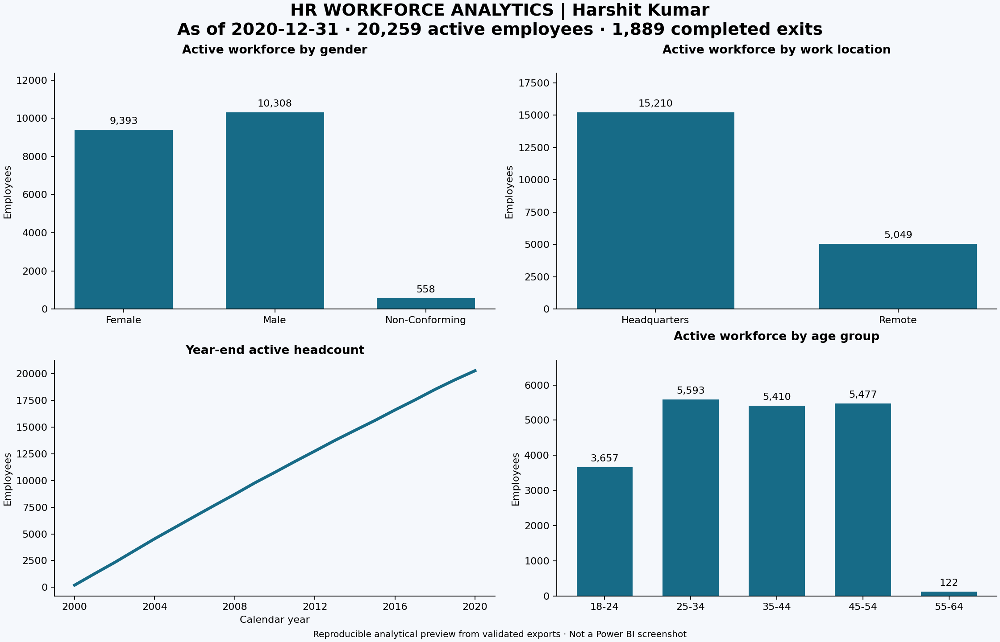
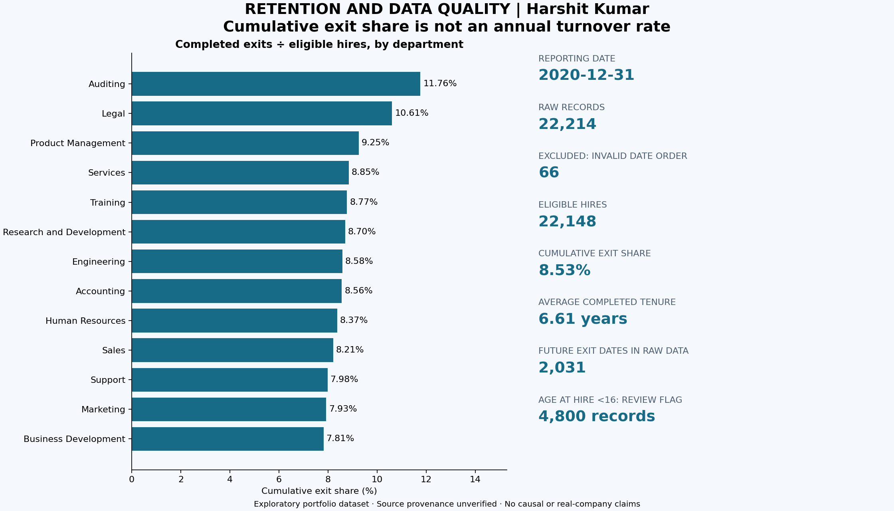

# HR Workforce Analytics — SQL and Power BI

**Harshit Kumar** · [GitHub](https://github.com/harshit-kumar-2912)

An exploratory workforce analytics portfolio covering data quality, employee demographics, historical headcount, and completed exits. The workflow uses **MySQL 8.0**, a reproducible **Python** validation/export pipeline, and an editable **Power BI** project.

The business question: **How did the workforce change, and what do its demographics and exit patterns look like at a consistent reporting date?**

## Validated snapshot

Reporting date: **December 31, 2020**, aligned with the final year of hiring data. Demographic charts describe employees active on that date, not everybody ever hired.

| Metric | Value |
| --- | ---: |
| Raw employee records | 22,214 |
| Excluded: hire date before birthdate | 66 |
| Eligible hires through reporting date | 22,148 |
| Active employees | 20,259 |
| Completed exits | 1,889 |
| Cumulative exit share | 8.53% |
| Average completed tenure of exited employees | 6.61 years |
| Headquarters share of active employees | 75.08% |

**Cumulative exit share is not annual turnover.** It is completed exits divided by eligible hires to the reporting date. Annual turnover is calculated separately using calendar-year exits divided by average opening/closing headcount.





These are reproducible analytical previews from validated CSV exports, **not Power BI screenshots**. [Download the two-page summary](docs/HR_Analytics_Summary.pdf).

## Project workflow

1. Preserve the original input and validate employee IDs.
2. Normalize mixed date formats using explicit two-digit-year rules.
3. Flag impossible date sequences and retain excluded records for traceability.
4. Define active/terminated status at a fixed date; keep missing exit dates as SQL NULLs.
5. Analyze demographics, job roles, locations, tenure and annual workforce movement.
6. Reconcile all employee-level dates/status and calendar-year metrics independently in SQL and Python.
7. Import employee-grain exports into a local Power BI model with reusable DAX measures.

## Repository guide

| Path | Contents |
| --- | --- |
| [data/raw](data/raw/) | Original supplied CSV |
| [data/processed](data/processed/) | Cleaned employee data, summaries, annual workforce and metrics |
| [sql](sql/) | Schema, repeatable cleaning, analytical queries and checks |
| [scripts](scripts/) | Export pipeline, MySQL loader/reconciliation, Power BI builder and previews |
| [powerbi](powerbi/) | PBIP report, local semantic model and DAX |
| [tests](tests/) | Date-boundary, regression, invariant and report-reference tests |
| [docs](docs/) | Definitions, interview guide, data dictionary and validation evidence |
| [archive](archive/) | Superseded SQL/PBIX retained for traceability; not the corrected workflow |

## Reproduce the data

Requirements: Python 3.10+. The main pipeline and tests use the standard library.

```bash
git clone https://github.com/harshit-kumar-2912/HR-Analytics-SQL-and-PowerBI.git
cd HR-Analytics-SQL-and-PowerBI
python scripts/pipeline.py
python -m unittest discover -s tests -v
```

Outputs are written under `data/processed/`; the raw CSV remains unchanged. Repeated runs produce identical files.

## Run MySQL

Requirements: MySQL 8.0, its `mysql` command-line client, and permission to create/use the dedicated `hr_analytics` database. The loader replaces this project's raw staging contents and rebuilds views; use a dedicated development schema.

Enable `local_infile` on your trusted development server for CSV loading; see [setup and validation](docs/VALIDATION.md).

```bash
python scripts/run_mysql.py --user root
```

The password is requested without echo and is not saved. Use `--client` with the full `mysql.exe` path if needed; `--host` and `--port` support a separate local server.

The runner loads the CSV, rebuilds cleaning views twice, executes every analytical query, and reconciles every employee's dates/age/status plus all annual rows against Python. Evidence is written to [docs/validation.json](docs/validation.json). SQL strict/date-validation modes remain enabled.

For manual analysis, run [sql/03_analysis.sql](sql/03_analysis.sql) after the loader succeeds.

## Open Power BI

Use [powerbi/HR.pbip](powerbi/HR.pbip), not the archived PBIX.

1. Install a current Power BI Desktop version supporting PBIP projects; enable the project option if required by your version.
2. From the repository root, set your actual absolute export path:

   ```bash
   python scripts/build_powerbi.py --data-folder "C:/path/to/HR-Analytics-SQL-and-PowerBI/data/processed"
   ```

3. Open `powerbi/HR.pbip` and refresh both imported tables. The project uses a local semantic model and intentionally starts without an embedded data cache.
4. Compare default KPIs with the table above, test the department slicer/cross-filtering, and check percentage totals.
5. Save an updated PBIX and capture Desktop screenshots after successful verification.

**Validation boundary:** the SQL/data workflow was executed and reconciled on MySQL 8.0.44. Report/model references pass static tests. Power BI Desktop rendering, Power Query refresh, DAX execution and interactions have **not been executed in this environment**. Complete the [Desktop checklist](docs/VALIDATION.md) before demonstrating the report.

## Assumptions and limitations

- External dataset publisher, original license and synthetic-data status were not supplied and remain **unverified**. No real employer or invented source is claimed. Verify provenance and usage terms before claiming licensed third-party or real-company data.
- There are 66 hire-before-birth exclusions, 2,031 future termination dates relative to the snapshot, and 4,800 raw records flagged for hire age below 16. The last flag is retained for review rather than silently rewritten. These are exploratory dataset results, not validated production HR statistics.
- Two-digit birth years `21–99` map to `1921–1999`, and `00–20` to `2000–2020`. Two-digit hire years map to `2000–2099`, matching the supplied range. These are explicit dataset assumptions, not universal rules.
- Department attributes are not effective-dated, so historical department transfers cannot be reconstructed.
- No causal claims, significance claims, or measured business improvements are inferred from descriptive charts.

Read the [metric definitions](docs/METRICS.md), [data dictionary](docs/DATA_DICTIONARY.md), and [interview guide](docs/INTERVIEW_GUIDE.md).

## Resume wording

After completing the Power BI Desktop checks:

> Developed an HR workforce analytics portfolio using MySQL and Power BI; analyzed 22,214 records, implemented date-quality checks and reproducible snapshot metrics, and reconciled SQL results against an independent Python pipeline.

Do not claim reduced turnover, production deployment, independently collected data, or a verified report refresh without evidence.

## Optional preview regeneration

```bash
python -m pip install -r requirements-preview.txt
python scripts/render_preview.py
```

GitHub Actions rebuilds data, runs regression tests and reconciles results against a disposable MySQL service on pushes and pull requests.
